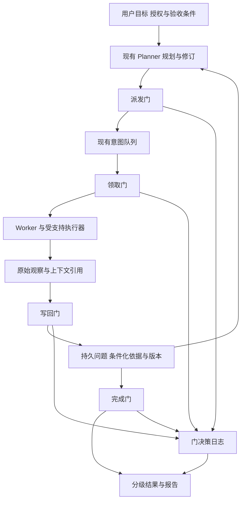

# ARTEX 问题驱动的实验搜索架构

创建日期：2026-10-15。复核更新：2026-10-16。源码基线：a9d11cb。状态：研发设计，新增机制尚未实施。

当前主方案保留现有 Planner、Worker、双图及 Go 和 PostgreSQL 主体，在派发、领取、写回、完成四个环节建立共用的程序约束，并持久化问题、观察、依据与版本。先验证这些机制对探索质量的实际改善，再决定是否改变控制循环。

独立搜索控制器降为条件性备选。只有主方案运行后仍出现可重复、可归因的全局调度问题，且简单规则不能有效解决，才进入独立控制原型；是否采用，由同等预算下的对照结果决定。

## 复核后的架构决定

| 原方案中的安排 | 复核后的决定 | 原因 |
| --- | --- | --- |
| 以新控制器为整体架构的中心 | 以现有循环中的四道门和持久记录为主交付物 | 显式状态的价值尚不能证明更换控制循环的必要性 |
| 问题、解释、证据缺口由新模式专有维护 | 先接入现有 Planner，跨轮和跨 Worker 复用 | 这部分收益可以独立获得和验证 |
| 双前沿由新控制器首先落地 | 先记录探索与证明的成本和等待情况，尝试阶段配额与简单优先级 | 先证明存在资源失衡，再承担复杂选择器的成本 |
| 六条路线作为新架构的能力插件 | 各路线沿原调度接入；R05 下沉为公共检查能力 | 避免为了使用某条能力而先迁移整套任务 |
| 先建设原型再确认主要收益来源 | 轨迹审计最先做，四组评估隔离收益来源 | 基础修复、结构化记录和控制器收益分别计算 |

这次调整保留条件化结论、真实实验和开放探索方向，改变的是实施顺序与控制器的立项门槛。各阶段交付和依赖以[创新路线与版本规划](创新路线/README.md)为准，基础修复详见[架构复核与演进设计](架构复核与演进设计.md)。

## 保留现有循环的主架构

Planner 继续提出和安排方向；程序控制其提交能否生效、依据能否复用，以及证据能否升级为目标完成。四道门是共用领域规则，不是另一个选择下一步工作的控制循环。

### 四道门的职责

| 门 | 现有接入位置 | 主线新增规则 |
| --- | --- | --- |
| 派发门 | `add_intent` 与共用意图创建操作 | 校验归属、授权、必要依据及其版本；机器可判前提按已注册谓词检查，待复核依据不得被当作已成立前提 |
| 领取门 | `server/engine.go` 的 `claimNext`、`db/exploration.go` 的 `ClaimIntent` | 在领取时重新检查依赖版本与可领取性；数据库内检查与状态变更保持一致，失败进入有原因的等待或复核 |
| 写回门 | `record_fact`、`report_finding` 及共用存储操作 | 保存观察引用和上下文，区分观察、解释与断言结果；节点、必要关系与状态原子提交 |
| 完成门 | `prove_goal`、`goal_met` 及最终完成判定 | 所有自动完成入口使用同一验收规则；检查证据充分性与适用条件，量化目标使用有明确定义的程序指标 |

新任务种子、人工投递和平台工具也存在意图创建路径。它们应调用共用领域操作，明确操作来源与人工决策，不能因绕开某个工具函数而跳过共同约束。

领取检查提高了前提检查的时效性，但不能消除领取后环境变化的窗口。受支持执行器在关键动作前和必要的结果后复查实际条件；外部状态没有可靠观察时保留未知。数据库事务不跨越网络请求。

Planner 和 Worker 仍可使用通用工具。四道门不能被描述为对任意 Bash、第三方工具和所有网络请求的完整拦截；需要作用范围或逐请求预算保证的操作，必须通过具备对应能力的执行适配器。

### 谓词权威与开放探索

机器谓词采用已注册的名称、版本、输入类型、可信观察来源及结果语义。只有程序实际完成的检查，才能在其适用范围内影响准入、依据有效性和结论升级。HTTP 状态码、唯一标记或 owner 字段只是观察要素，不能各自单独证明权限违规。

模型标注采用开放词表，用于解释、提出候选、估计相对价值和建议复核。模型填写的 `observed`、角色标签或评分不构成程序背书。证明可以由多项真实观察和已实现推导规则共同组成，不要求所有顶层结论都被标为 `observed`。

复核建议与阻断状态分开。模型可以登记疑似冲突，只有已注册规则或明确人工决定才能改变依据有效性；必要条件缺证据时，由程序的 unknown 处理规则决定暂缓，不能由模型自由标签控制准入。

未支持的断言保持候选或进入人工复核。封闭的是自动判定规则集合，开放发现仍允许提出新问题、准备前提和执行有边界的探索实验。模式同时按路线与谓词能力控制，不能用路线整体晋级替代单项检查器的验证。

### 观察明细与计划依据

fact 可以继续承担简洁摘要；其下保存独立观察明细或稳定的明细引用，包括实际身份、对象、时间、方法、状态及原始记录。不同条件下的观察可以被摘要汇总，但不能合并为无条件真值。

当前 `record_fact` 的工具说明要求模型汇总多项观察，并非数据库自动合并。为避免结构化前丢失信息，受支持执行器先保存原始观察和上下文，模型随后撰写摘要。现有 `confirmed` 工作流状态与新的断言评估状态分开迁移，不能直接把所有历史节点当作已独立验证。

计划持久化需要设计依据引用、预期产出引用和版本。尚未产生的事实用计划输出占位引用表达，产出后再绑定实际观察或断言；步骤是否完成从有效产出派生，待办勾选不能代替证据。R01 的语义复核在此基础上增量接入。

复用现有 `TriggerEvent` 与 debounce 唤醒 Planner；依据失效和复核待办必须先持久化，启动与恢复时重新扫描。内存通知用于降低延迟，不作为唯一的变更记录。

### 公共基线与执行通道

建设按目标、主体、对象、状态和用途隔离的基线记录，统一来源引用、版本、复查期限和失效规则。R02 的拥有者对照、R03 的正常流程和 R05 的会话健康共享基础设施，各自保留不同的判定器。

首个协议原生通道采用结构化 HTTP 执行器，支持会话注入、动态依赖提取、对照关联和实际请求响应记录，复用现有证据设施。是否经过全局流量捕获与是否有可靠观察分别判断，不因接入路线自动打开全局捕获。

Bash 和其他工具继续作为通用通道。证据资格按来源、完整性、上下文和可核对程度判断；HTTP 并非天然充分，具有可靠执行记录的命令输出也不天然低级。未接入结构化适配时明确缺少哪些能力。

### 并发与副作用

可以新建会话或受控对象时，优先用资源隔离减少互相污染。权限差分仍需比较同一被测对象；不可复制的业务状态、共享后端和竞态测试不能用新对象替代。

冲突记录包含认证域或租户、主体、对象集合、状态域及读写效果。判冲突时比较共同资源，即使主体不同，写入同一对象也可能冲突，不能仅按完整元组是否相等互斥。

执行器给出已知作用范围，未知部分保守处理。模型可以收窄授权范围或要求更强隔离，不能缩小执行器已知的副作用范围以绕过保护。已发出但结果未知的写动作先对账，不直接重放。

## 报告与停止规则

门决策日志与新判定器同步交付，记录实际允许、拒绝、暂缓或要求复核的决定，以及输入引用、上下文版本、谓词版本、原因和关联任务。未评估的候选不能被日志描述成已经比较落选。

报告展示观察、规则来源、适用条件、证据等级和缺失内容。沿用现有证据版本与独立复测界面；新实验的四值结果不直接替换复测的 `reproduced/fixed/inconclusive`。尤其是 `not_reproduced`，必须附方法、有效对照与条件，不能显示成整体安全。

任务目标函数先追求预算内有充分证据的目标产出，同时约束错误完成、无效实验和资源成本。探索广度、证明推进和必要状态准备分别计量；双前沿只是避免偏科的手段，配额随任务阶段验证调整。

主线增加有边界的停止规则：预算耗尽、无法恢复的前提阻塞，或在预先约定的观察窗口内，候选复核与有限替代策略均未产生可用推进时，记录部分结果与停止原因。窗口和成本阈值在评估前登记。长期低反馈路线可能仍有价值，不能只按短期无新增事实剪除。

目标已达成、预算耗尽、前提阻塞、阶段收益不足和人工停止是不同终止原因。停止探索不等于验收通过，更不等于已经证明不存在漏洞。

## 主线收益与控制器增量的区分

| 希望改善的问题 | 主线首先提供的机制 | 新控制器仍需额外证明什么 |
| --- | --- | --- |
| 无效测试被当成有效结果 | 公共有效性检查、基线与条件化结果 | 其全局选择是否能进一步降低恢复成本 |
| 依据失效后仍继续执行 | 持久依赖、版本检查、复核与领取门 | 简单重新唤醒和队列规则之外的重新调度收益 |
| 错误完成任务 | 共用完成门、证据引用和验收器 | 完成正确性本身不计作替换控制器的收益 |
| 发现与证明失衡 | 成本台账、阶段配额和 Planner 提示 | 独立选择器是否稳定改善全局预算配置 |
| 多 Worker 条件污染 | 资源隔离、执行适配与冲突检查 | 是否改善共同约束下的有效吞吐 |
| 难以解释决策 | 门日志、依据与报告 | 是否让跨问题取舍更可核对且值得额外开销 |

上述机制的价值是待测预期。不能把图事务、恢复、证据和四道门已经获得的改善再次记为控制器增量。

## 什么时候才需要新控制器

### 开始独立控制原型的必要条件

进入 A2 前，以下条件必须同时满足：

1. 主线 M1、M2 已在拟研究的任务类型中通过验收；记录能够区分策略、执行、证据、门规则和状态恢复问题。
2. 同类调度失败在独立任务或重复重置运行中复现，保留完整候选、预算、依据版本、门决定和执行后果；孤立案例不足以立项。
3. 当时存在前提满足且有价值的替代候选，失败主要来自跨轮选择或全局资源分配，而非没有可执行动作。
4. 已比较阶段配额、优先级、去重、依赖唤醒等较小修改；仍有未解决问题，并能说明替换选择权的具体收益机制。
5. 提前登记任务集、重复次数、主指标、允许退化范围和全部成本上限，形成可验证的对照计划。门槛未登记时不进入自动控制原型。

这里要求的是对目标任务类型的主线验证，不要求六条路线全部完成。离线分析可以随审计进行，但不能成为主线交付的额外依赖。

### 可以构成立项依据的残余问题

| 残余问题 | 需要的证据 | 应先排除的原因 |
| --- | --- | --- |
| 探索或证明持续饥饿 | 可执行候选长期等待，预算被另一类工作消耗，简单阶段配额仍未改善 | 候选无效、漏通知、前提未恢复 |
| 跨问题依赖反复失序 | 持久依据和事件均正确，Planner 仍反复选择不合时机的方向，导致有效链路中断 | 依赖 schema 缺失、领取检查错误、恢复丢状态 |
| 全局预算取舍持续偏离目标 | 相同预算下候选质量可用，但跨轮选择反复造成可避免的浪费 | 工具失败、模型没有提出可用候选、预算统计遗漏 |

数据丢失、`Link` 吞错、缺少权限规则、会话混用、报告缺证据和提示词单次失误，都优先在主线修复。任务更复杂、节点更多或新控制器名称更有创新感，也不能单独触发立项。

### 采用新控制器的晋级条件

A2 只在受控任务中比较独立选择权。它必须相对完整主线提高预先登记的主要产出指标，或在产出和正确性达到预设要求时降低总成本；优势需在重复配对运行及未参与调参的保留任务上出现。

同时检查错误完成、误报漏报、无法判定、开放发现能力、短任务耗时和总成本。收益若依赖更多请求、更强模型、额外规则输入或改变任务定义，不归于控制器。样本不足时保留观察或建议模式。

未达到上述条件，继续使用门化 Planner。只有受支持任务类型分别通过验证，才逐步扩大使用范围，不直接替换所有任务的默认控制循环。

## 条件备选的新控制器设计

### 决策单位与控制权

只有通过准入后，才将持久问题、可能解释和证据缺口作为主要调度单位。模型提出少量候选，独立选择器在现有四道门之上承担跨问题选择和预算分配；观察、证据、验收和报告沿用主线。

候选生成器采用无工具或受限制的只读调用，不能同时直接派发、执行和宣布完成。解释可以并存，不视为互斥或完整枚举；未知前提生成验证任务，不能补写成事实。

### 探索与证明双前沿

探索前沿寻找新入口、对象关系和业务结构，证明前沿补齐已有方向的对照、前提与效果证据。状态准备与诊断计入服务对象及总成本，不能成为账外第三类开销。

先检查共同的准入条件，再按目标相关性、可消除的不确定性、后续行动和已知成本比较候选。模型评分只作启发，不解释成校准成功概率。首版有界比较，不要求蒙特卡洛树搜索或环境模拟器。

双前沿的独立价值须相对主线的阶段配额验证，比例随任务阶段调整。没有新事实只触发策略复核，不证明所有方向无效。

### 原组件的变化与切换

| 位置 | 条件备选中的变化 |
| --- | --- |
| [server/engine.go](../server/engine.go) | 在指定任务类型接入独立选择器，沿用生命周期、预算与四道门 |
| [agent/planner.go](../agent/planner.go) | 作为候选生成器或原模式规划器，按任务模式选择 |
| [agent/tools.go](../agent/tools.go) | 派发与完成继续调用共用领域规则，候选生成器不持有直接提交权 |
| [agent/worker.go](../agent/worker.go) | 沿用主线执行适配、观察记录和副作用处理 |
| [db/exploration.go](../db/exploration.go) 与证据设施 | 复用同一份状态、引用和版本，避免建立第二套事实来源 |

保持同一 Go 进程与 PostgreSQL，不默认引入微服务、额外图数据库或训练世界模型。每个任务同一时刻只有一个决策控制者，模式切换先停止新派发、收尾在途工作并核对未知动作，再迁移检查点。

判断分支不是目标环境的物理副本。只有确实具备隔离快照的夹具才允许重置比较，不能把搜索回溯解释成真实目标可回滚。

## 原型版本与对照评估

| 版本 | 修订后的定位 | 晋级条件 |
| --- | --- | --- |
| A0 状态观察 | 原状态原型归入主线 M0、M2，检查观察、问题和依据恢复 | 不新增控制循环 |
| A1 候选旁观 | 按需要比较候选和实际决策，计入离线分析成本 | 不派发目标请求，不改变主线选择 |
| A2 独立控制原型 | 仅在准入条件满足后，于受控只读 HTTP 任务中替换选择权 | 相对完整主线满足预登记的增量收益及退化限制 |
| A3 组合原型 | 对已通过 A2 的类型研究多步状态和跨问题调度 | 保留任务验证、模式回退及未知副作用对账通过 |

四组对照分别是：

| 组别 | 范围 | 作用 |
| --- | --- | --- |
| E0 原实现 | 固定源码与配置的现状基线 | 识别原有错误与成本 |
| E1 可靠性加固 | M1 的事务、恢复、错误传播及完成旁路加固 | 分离基础修复收益 |
| E2 门化 Planner | E1 加 M2 的四道门、结构化记录及共同能力 | 主交付物；后续路线逐项与其自身基线比较 |
| E3 独立控制器 | 与对应 E2 使用同版本的门、路线、执行器和证据机制，仅改变候选选择与预算分配 | 测量控制器增量 |

E3 与 E2 使用相同模型、策略输入、工具、账号、初始快照和总预算；所有准备、对照、诊断、模型与人工成本入账。原有实际工具可达性也需冻结，不能把默认未绑定的 `goal_met` 描述成所有 E0 任务必经的缺陷。

隔离选择权的比较还需固定候选生成协议、可用信息与候选上限。若同时更换生成器或增加候选搜索，另做消融，不能将更好的候选来源全部归于控制器；离线选择检查可直接使用同一候选集。

夹具覆盖失效会话、对象不存在、合法共享、状态污染、依据反驳，以及必须发现新入口才能推进的任务。配对运行前重置，随机化顺序并重复；针对控制器再做阶段配额和单分支选择的消融。

## 研究参考与适用边界

| 参考 | 支持的机制 | 采用边界 |
| --- | --- | --- |
| [LLM Modulo 框架](https://proceedings.mlr.press/v235/kambhampati24a.html) | 模型候选与外部检查反馈 | 没有覆盖所有渗透语义的完整验证器，不承诺普遍正确 |
| [Language Agent Tree Search](https://arxiv.org/abs/2310.04406) | 候选、动作与环境反馈结合 | 真实目标通常不能回滚，不照搬模拟搜索 |
| [Hypothesis Evolution Protocol](https://arxiv.org/abs/2607.09195) | 显式问题、假设与依据更新 | 不继承其他领域的效果，也不采用无校准的信念概率 |

相对 ARTEX 的主要增量首先是让依据、准入和完成权具有可检查的约束。独立控制权是否值得迁移，是需要另外证明的工程命题。
